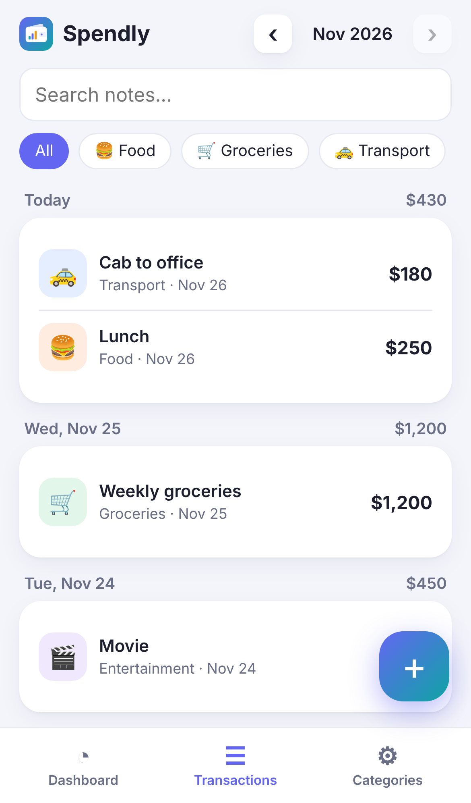

# Spendly — Daily Expense Tracker

A mobile-first expense tracker that installs on your phone like a native app (PWA).
No sign-up, no server: your data stays on your device and it works offline.

<p>
  
  
  
</p>

## Features

- **Dashboard**: total spent this month, a budget progress bar, today's total, daily average, a 7-day bar chart, a category donut chart with breakdown, and recent expenses.
- **Transactions**: grouped by day with daily totals, search, and filter chips by category. Tap any expense to edit or delete it.
- **Categories**: 8 built-in categories (Food, Groceries, Transport, Shopping, Bills, Health, Entertainment, Other). You can add your own with an emoji and colour, or delete them.
- **Category budgets**: set a monthly limit for each category. A budget carries forward to the following months until you change it, so you can revise it month by month (use ‹ › to pick the month) without changing past months. The dashboard shows how much is left or over for each category (amber at 80%, red when over), the add-expense sheet shows what's left as you type, and you get a warning when an expense takes a category over its budget.
- **Bank SMS import**: copy a bank or UPI SMS and tap **📋 Paste bank SMS**. Spendly fills in the amount, payee and date, and suggests a category (Swiggy → Food, Uber → Transport, …). It remembers the category you pick for each payee. It warns if the SMS is already recorded, and ignores money-received SMS, OTPs and payment requests. The SMS is read on the phone and never stored or sent anywhere. On iPhone, a Shortcuts automation can copy bank SMS for you automatically; the steps are in the app under Categories → Bank SMS.
- **Backup & restore**: **Back up now** saves a `.json` file (on iPhone choose *Save to Files* → iCloud Drive). **Restore from file** brings everything back (expenses, categories, budgets). The dashboard reminds you if you haven't backed up in 30 days.
- **Settings**: overall monthly budget (optional; otherwise the total of your category budgets is used), currency (₹, $, €, £ and more), CSV export, delete all data.
- Browse previous months with the ‹ › arrows in the header.
- Light and dark mode follow your phone's setting.

## Put it on your phone

1. Host it (one-time): on GitHub, open **Settings → Pages**, set **Source** to **GitHub Actions**.
   Once this folder is on `master` (the default branch), the workflow `.github/workflows/deploy-pages.yml` publishes it to
   `https://<your-username>.github.io/<repo-name>/` (you can also run it from the **Actions** tab).
2. Open that link on your phone:
   - **Android (Chrome)**: tap **⋮ → Add to Home screen / Install app**.
   - **iPhone (Safari)**: tap **Share → Add to Home Screen**.
3. The Spendly icon appears on your home screen and opens full-screen like a native app.

## Run locally

```bash
cd expense-tracker
python3 -m http.server 8000
# open http://localhost:8000
```

## Project structure

```
expense-tracker/
├── index.html      # app shell: dashboard, transactions, categories screens
├── styles.css      # mobile-first styling, dark mode
├── app.js          # state, rendering, charts, backup/restore, localStorage persistence
├── sms.js          # reads bank/UPI SMS: amount, payee, date, reference; suggests a category
├── manifest.json   # PWA manifest (name, icons, standalone display)
├── sw.js           # service worker for offline use
└── icons/          # app icon (SVG source + generated PNGs)
```

Data is stored only on the device, in the browser's `localStorage` under the key `spendly.v1`. Nothing is sent to any server. Use **Back up now** to keep a copy.
